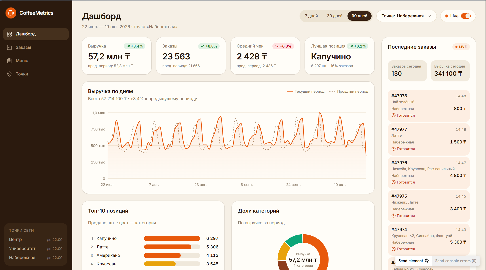

# CoffeeMetrics

Аналитический дашборд сети кофеен: выручка, заказы, топ позиций, доли категорий и почасовая загрузка — с живой лентой заказов.



## Стек

| Часть | Технологии |
| --- | --- |
| Frontend (`apps/web`) | Next.js 16, React 19, TypeScript strict, Tailwind CSS v4, shadcn/ui, Recharts, TanStack Query |
| Backend (`apps/api`) | Hono, TypeScript strict, Drizzle ORM, SQLite (better-sqlite3), Pino, Zod-валидация |
| Shared (`packages/shared`) | Zod-схемы и контракты, общие для фронта и бэка; типизированный Hono RPC-клиент |
| Monorepo | pnpm workspaces, Biome (lint + format) |

## Запуск

```bash
pnpm install
pnpm dev        # web → http://localhost:3000, api → http://localhost:3001
```

При первом старте API сам применяет миграции и наполняет БД детерминированными данными (~109 тыс. заказов за 185 дней по 3 точкам). Дополнительно раз в ~25–50 секунд создаются «живые» заказы — лента на дашборде обновляется сама (тоггл **Live** в шапке).

Полезные команды:

```bash
pnpm -r typecheck   # строгий typecheck всех пакетов
pnpm -r build       # продакшн-сборка
pnpm lint           # biome check
pnpm db:generate    # drizzle-kit: сгенерировать миграцию по схеме
pnpm db:seed        # пересидировать БД с нуля
```

## Структура

```
apps/
  web/            # Next.js App Router: Дашборд, Заказы, Меню, Точки
  api/            # Hono API: metrics/orders/menu/locations + симулятор заказов
    drizzle/      # SQL-миграции
    data/         # SQLite файл (gitignored)
packages/
  shared/         # контракты API (zod + типы)
```

## API

Базовый префикс `/api`, ответы в конверте `{ data }` | `{ error }`. Браузер ходит через same-origin rewrite `/api/*` → `localhost:3001` (CORS не нужен); прямые запросы к API разрешены с localhost-origins.

| Эндпоинт | Описание |
| --- | --- |
| `GET /api/health` | healthcheck |
| `GET /api/metrics/summary?period&locationId` | KPI + дельты к прошлому периоду |
| `GET /api/metrics/revenue-daily?period&locationId` | выручка по дням (текущий/прошлый период) |
| `GET /api/metrics/top-items?period&locationId` | топ-10 позиций по шт. |
| `GET /api/metrics/categories?period&locationId` | доли категорий по выручке |
| `GET /api/metrics/hourly-load?period&locationId` | матрица день×час для тепловой карты |
| `GET /api/orders?period&locationId&status&page&q` | заказы с пагинацией и фильтрами |
| `GET /api/orders/live?locationId` | последние заказы + статистика сегодня |
| `GET /api/menu/stats?period&locationId` | меню + продажи по позициям |
| `PATCH /api/menu/:id` | `{ isActive }` — вкл/выкл позицию |
| `GET /api/locations` · `GET /api/locations/stats?period` | точки и их метрики |

`period`: `7 | 30 | 90` (дней), `locationId` опционален — без него агрегация по всей сети.

## Конфигурация

См. `.env.example`. Основное: `PORT`, `WEB_ORIGIN` (CORS), `DATABASE_PATH`, `SIMULATE_ORDERS=0` — выключить генератор заказов, `SEED_ON_START=0` — не сидировать при старте.

> SQLite использован как fallback (нет локального Postgres/Docker). Для продакшена замените драйвер `better-sqlite3` на `pg`/`postgres-js`, пропишите `DATABASE_URL` и перегенерируйте миграции — остальной код неизменен.
